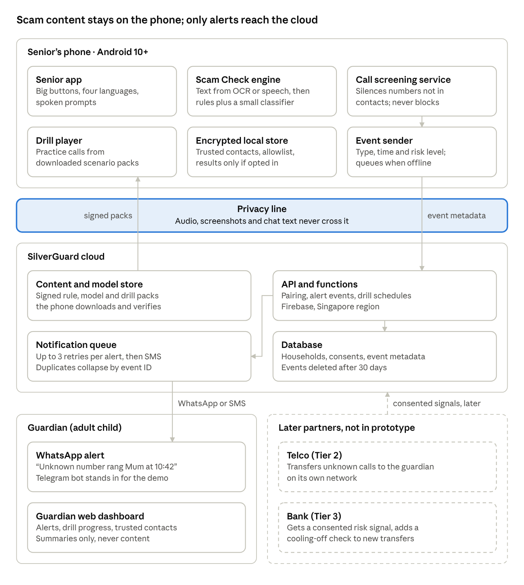

# SilverGuard AI

A scam-prevention prototype for Singapore seniors facing AI voice-clone "family emergency" scams. Built for NTU CC0007 (Science & Technology for Humanity), Cluster D-23, Assignment 2.

SilverGuard checks suspicious voice notes, screenshots and chats on the senior's own phone, and brings a family member in before any money moves.



## Three layers of protection

| Layer | When it acts | Feature |
| --- | --- | --- |
| 1 | Before the senior answers | **Guardian Alert**: calls from unknown numbers are silenced and a family member is told at once. A telco partner can later transfer the call itself. |
| 2 | During the scam | **Pause & Verify** button, **Scam Check** for voice notes, screenshots and pasted chats, and **Family Drill** practice calls. |
| 3 | Before money moves | **Bank cooling-off**: a partner bank adds an extra check after a likely scam (later). |

## Design principles

- The AI runs on the phone. Audio, screenshots and chat text never leave it.
- Detect the scam script (money, urgency, secrecy, a new number), not the cloned voice.
- Never block a call and never say "safe": silence, alert, then verify with family.

## What's in this repo

| Path | Contents |
| --- | --- |
| [`docs/prototype-design.md`](docs/prototype-design.md) | Full system design: requirements, architecture, feature flows, Scam Check engine, data and privacy, APIs, scale, partner interfaces, trade-offs, build plan |
| [`docs/diagrams/`](docs/diagrams/) | Architecture, Guardian Alert flow, 16-week build timeline |

## Planned code structure (not built yet)

```
apps/senior-android/   Kotlin app: call screening, Scam Check, Pause & Verify, drills
backend/               Firebase functions, Firestore rules, alert queue
dashboard/             Guardian web dashboard
demo/scam-check-web/   Browser demo for the Week 13 pitch: rules-only Scam Check + Telegram alert
```

## Status

Design stage. The pitch demo is due before the Week 13 tutorial; the Phase 1 MVP plan in the design doc assumes seed funding.

The editable version of the design doc lives in Claude and is private to its owner until shared from the page's Share menu.
