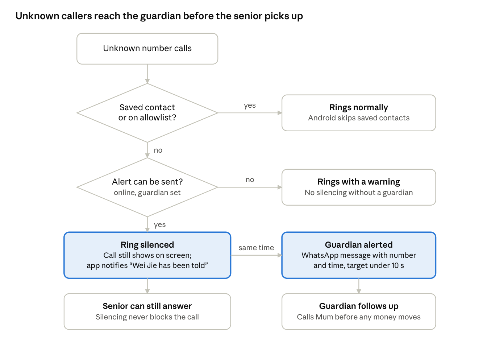
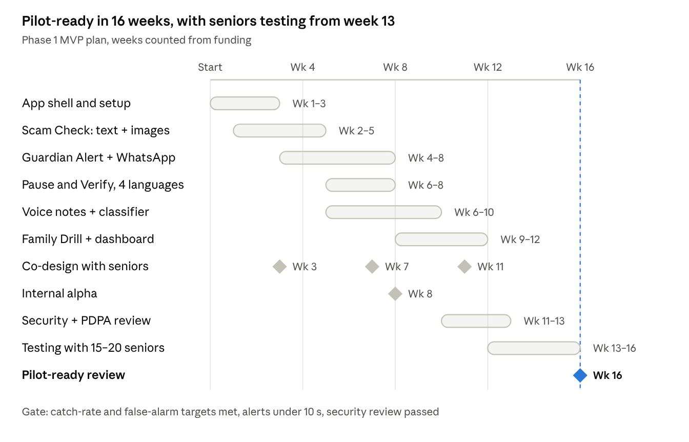

# SilverGuard AI Prototype Design

22 Oct 2026 · Zhang Yaoyun · exported from the team's Claude doc, which stays the editable source

## Summary

SilverGuard's prototype is an Android app that checks suspicious voice notes, screenshots and chats on the phone itself, and alerts a family member within seconds of an unknown call. It is designed at two levels:

- **Pitch demo, before the Week 13 tutorial (about 2 weeks, student team):** clickable screens, a working Scam Check in the browser, a live guardian alert sent to a teammate's phone, and a recorded drill.
- **Phase 1 MVP, 16 weeks after funding (3 engineers and a part-time designer):** the Android app and a thin cloud backend, ready for a 200-household pilot.

Five decisions shape everything below:

1. The AI runs on the phone; audio, images and chat text never leave it.
2. The verdict comes from scam-script cues (money, urgency, secrecy, a new number), not from detecting a cloned voice.
3. Unknown calls are silenced and the guardian alerted, never blocked; the senior can always answer.
4. Android comes first; iPhone users get everything except call screening.
5. Telco call transfer and bank cooling-off are designed as interfaces now and built later with partners.

## Requirements

The prototype must prove four features work for real seniors without sending scam content off the phone.

### Functional

| Feature | The prototype must | Runs on |
| --- | --- | --- |
| Guardian Alert | Silence calls from numbers not in contacts or the allowlist, alert the guardian, and let the senior answer anyway | Android 10+ |
| Pause & Verify | Offer one button, speak a 3-question checklist, and dial a trusted contact's saved number | Android |
| Scam Check | Accept shared voice notes, screenshots and pasted text; return a risk level, reasons and a "call family" button | Android |
| Family Drill | Play scheduled practice calls, score whether the senior paused, and give a debrief | Android |
| Guardian dashboard | Pair by QR code, show alerts and drill progress, schedule drills | Web, any phone |
| Setup and consent | Let the senior choose the guardian, languages and what the guardian sees, and remove the guardian anytime | Android |

### Non-functional targets (to be measured in testing)

| Requirement | Target |
| --- | --- |
| Privacy | Audio, images and chat text never leave the phone; the cloud holds event metadata only |
| Alert speed | Guardian alerted within 10 s of the call ringing (95th percentile) |
| Scam Check speed | Text under 2 s, screenshot under 5 s, 60-second voice note under 20 s on a mid-range phone |
| Offline | Scam Check and Pause & Verify work with no data connection |
| Accessibility | Main buttons at least 64 dp, default text at least 20 sp, every prompt also spoken |
| Languages | English, Mandarin, Malay and Tamil; dialect audio in drills only |
| App size | Core app under 50 MB; model packs download over Wi-Fi after setup |
| Retention | Event metadata deleted after 30 days; consent records kept as proof |

### Constraints

- Android shows a call-screening app only numbers not in the user's contacts, and lets it block, reject or silence a call, not forward it ([Android Developers](https://developer.android.com/develop/connectivity/telecom/dialer-app/screen-calls)).
- Google Play has barred apps from capturing call audio through accessibility tools since May 2022 ([The Register](https://www.theregister.com/2022/04/22/google_banning_thirdparty_callrecording_apps/)).
- iPhone apps get no live notice of incoming calls, and no outside app can screen WhatsApp or Telegram calls.
- Singapore's PDPA governs every piece of personal data the app collects.
- Team: the student group builds the demo; the MVP assumes 3 engineers and a part-time designer, as in the pitch budget.

### Assumptions to test

- [ ] Most target seniors use Android 10 or later with mobile data.
- [ ] Guardians use WhatsApp daily and will accept alerts there.
- [ ] Scam scripts contain recognisable cues: money, urgency, secrecy, a new number.
- [ ] Seniors will share a voice note or screenshot when unsure.
- [ ] WhatsApp's share option still exports voice notes to other apps.
- [ ] A senior gets about 3 calls a day from unknown numbers; this sets alert volume and cost.

## Architecture

Everything that touches scam content runs on the senior's phone; the cloud only routes alerts, stores consent and serves signed model packs.


Only two things cross the privacy line: event metadata going up, and signed packs coming down.

| Component | Technology | Why this choice |
| --- | --- | --- |
| Senior app | Kotlin, Jetpack Compose, Android 10+ | Needs Android's call-screening role and on-device models |
| On-device AI | whisper.cpp, ML Kit text recognition and language ID, TensorFlow Lite | Free, works offline, nothing uploaded |
| Local store | Encrypted SQLite (Room with SQLCipher) | Contacts and results stay protected if the phone is lost |
| Backend | Firebase Auth, Firestore, Cloud Functions, Cloud Tasks and Storage, Singapore region | Little to run, scales on its own, local data location |
| Guardian alerts | WhatsApp Business Platform utility messages, SMS fallback; Telegram bot for the demo | Reaches guardians in the app they already use |
| Guardian dashboard | Web app on Firebase Hosting | Works on any phone, nothing to install |
| Device integrity | Play Integrity through Firebase App Check | Stops fake apps posting events |

## Feature flows

All four features follow one rule: when in doubt, slow the money down and bring in family.

### Guardian Alert



The silence decision happens on the phone with no network call, so the call is never delayed; the alert goes out in parallel.

### Pause & Verify

1. The senior taps "Is this really them?" on the home screen or a lock-screen shortcut.
2. The app asks three questions aloud in the senior's language: Did they ask for money? Did they say it's urgent or secret? Are they calling from a new number?
3. Any "yes" turns the screen into one big button, "Call Wei Jie now", which dials his saved number, never the caller's.
4. The guardian gets "Mum pressed Pause & Verify at 10:44".
5. If he doesn't pick up within 2 minutes, the app offers the next trusted contact.

### Scam Check

1. The senior long-presses a voice note, screenshot or message, taps Share, then SilverGuard; or pastes text inside the app.
2. The app shows "Checking. This stays on your phone."
3. A result card gives the level in words and colour and up to three reasons, and reads them aloud.
4. Two buttons follow: "Call Wei Jie" and "Open ScamShield to report" (if installed).
5. The input is deleted. A High risk result also alerts the guardian, if the senior allowed it.

### Family Drill

1. During setup the senior agrees to practice calls and sets quiet hours; drills can be paused anytime.
2. The guardian schedules a drill, or the app picks a time inside the agreed window.
3. A practice call screen plays a recorded scam scenario, voiced by paid actors in four languages and common dialects.
4. The app records whether the senior pressed Pause & Verify or hung up, and how fast.
5. A debrief replays the red flags and praises the pause; the guardian sees the score trend, never the audio.

## Scam Check engine

Scam Check flags the scammer's script, not the cloned voice: it turns every input into text, then looks for the cues every family-emergency scam needs. Voice-clone detectors are unreliable on new cloning tools and phone-quality audio, so a voice score never decides the verdict.

1. **Receive.** A voice note, screenshot or text arrives through Android's share sheet or inside the app.
2. **Turn it into text, on the phone.**
    - Voice note (WhatsApp sends Opus audio): decoded, then transcribed by an open multilingual speech model (the Whisper family, run through whisper.cpp).
    - Screenshot: Google ML Kit's on-device text recognition reads it, keeping who said what from each bubble's position.
    - Pasted text: used as is.
3. **Detect the language** with ML Kit's on-device language identification; mixed-language messages run through every matching rule set.
4. **Find cues** with two checks that run side by side:
    - Rules: word lists and patterns for each cue family below, in four languages plus Singlish spellings.
    - A small text classifier (a distilled multilingual model, compressed to run with TensorFlow Lite) that scores how scam-like the whole message is.
5. **Combine** the two into one of three levels (below). There is no "safe" level.
6. **Explain** with pre-written sentences per cue, shown and spoken in the senior's language, so the app never invents a reason.
7. **Delete** the input. Only the level and cue names stay, and only if the senior opted in.

| Cue family | What it looks for | Weight |
| --- | --- | --- |
| Money request | transfer, PayNow, bank account, gift card, crypto, an amount | High |
| Secrecy | "don't tell Mum", "keep this between us" | High |
| Identity switch | "new number", "lost my phone", "can't talk, voice note only" | High |
| Urgency | now, tonight, hospital, accident, arrested | Medium |
| Authority | police, court, bank officer, government | Medium |
| Emotional pressure | crying, "I'm scared", "please help me" | Low |

**Risk levels.** *High risk*: a money request plus any other High or Medium cue, or a classifier score above the high threshold. *Check with family*: one High cue alone, or a middle classifier score. *No warning signs found*: everything else, still with a reminder to verify any money request.

Thresholds are set on the test set, not guessed.

**Languages.** Rules and classifier cover English, Mandarin, Malay and Tamil. Open speech models handle Hokkien and Teochew poorly, so a voice note the engine cannot transcribe gets "Couldn't check this; ask family to listen", never a pass. ML Kit's text recognition covers Latin and Chinese scripts; Tamil screenshots need another engine (open question).

**Evaluation.** A held-out test set mixes scam scripts rewritten from SPF and NCPC advisories with genuine family messages from volunteers, in all four languages. The team tracks four numbers per language: catch rate, false alarms on genuine emergencies, "couldn't check" rate, and time taken on the slowest supported phone. The pilot gate sets the targets.

## Data and privacy

The privacy promise is enforced by design: scam content is processed in memory on the phone and deleted, and the cloud stores only who is linked, what they agreed to, and when alerts fired.

| Data | Where it lives | Kept for | Who can see it |
| --- | --- | --- | --- |
| Voice notes, screenshots, chat text | Phone memory, during analysis only | Deleted when the result shows | No one |
| Scam Check results (level, cue names) | Phone, encrypted | Only if the senior opts in | Senior |
| Trusted contacts, allowlist | Phone, encrypted | Until changed | Senior |
| Household and members | Cloud database | While the account is active | Senior, guardian |
| Consent records | Cloud database | Account life, as proof of consent | SilverGuard staff, on request |
| Alert events (type, time, level, caller number if allowed) | Cloud database | 30 days | Senior, guardian |
| Drill outcomes (paused or not, seconds taken) | Cloud database | 12 months | Senior, guardian |
| Rule, model and drill packs | Cloud storage and phone | Current and previous version | Anyone (no personal data) |

**Cloud collections (Firestore, Singapore region)**

| Collection | Key fields |
| --- | --- |
| households | seniorId, languages, createdAt |
| members | householdId, role (senior or guardian), displayName, alertChannel, phone (guardians only) |
| consents | memberId, scope, textVersion, grantedAt, revokedAt |
| events | householdId, type, occurredAt, riskLevel, callerNumber, deliveryStatus, expireAt |
| drills | householdId, scenarioId, scheduledFor, status, paused, secondsToPause |

**Consent and PDPA.** Each permission is its own consent scope: guardian alerts, sharing the caller's number, drill progress, and later bank signals. The senior can withdraw any scope in two taps, and a "What Wei Jie can see" screen explains it in plain words.

Before the pilot, appoint a data protection officer, write a breach-response plan and enforce the retention limits above; PDPA has required breach notification since February 2021. This is a design, not legal advice, so check the PDPC's guides before launch.

**Guarding against misuse by family.** The guardian never sees content, only events. The senior chooses the guardian and can remove them anytime, which also switches off silencing. Every guardian action, such as scheduling a drill, is logged and visible to the senior.

## APIs, events and error handling

Eight HTTPS endpoints and one alert queue cover the prototype, and every failure path ends with a ringing phone or a person told what happened.

| Endpoint | Called by | Purpose |
| --- | --- | --- |
| POST /v1/households | Senior app | Create the household at setup |
| POST /v1/pairing-codes | Senior app | Make a 6-digit code and QR, valid for 10 minutes |
| POST /v1/pairing-codes/{code}/claim | Guardian dashboard | Link the guardian once the senior approves on the phone |
| POST /v1/events | Senior app | Report an alert event; the event ID makes retries safe |
| GET /v1/households/{id}/summary | Guardian dashboard | Recent alerts and drill results |
| POST /v1/drills | Guardian dashboard | Schedule a practice call |
| GET /v1/content/manifest | Senior app | Latest pack versions, download links, SHA-256 hashes, signature |
| DELETE /v1/members/{id} | Senior app | Remove the guardian and revoke their consents |

The event the phone sends for an unknown call is the only thing that crosses the privacy line:

```json
{
  "eventId": "7f3c2a9e-0d41-4b8e-9a52-1c6e2f0b7d13",
  "type": "unknown_call",
  "occurredAt": "2026-11-02T10:42:07+08:00",
  "callerNumber": "+65XXXXXXXX",
  "riskLevel": null
}
```

**Alert delivery**

1. The event write triggers a Cloud Function, which puts one job on a Cloud Tasks queue named by the event ID, so duplicates collapse.
2. The sender posts a WhatsApp utility template message to the guardian; the class demo uses a Telegram bot instead.
3. On failure it retries after 1, 2 and 4 seconds, then falls back to SMS.
4. If SMS also fails, the event is marked undelivered and the senior's phone asks: "Wei Jie could not be reached. Call him now?"

| Failure | What happens | Why |
| --- | --- | --- |
| Phone offline when the call arrives | Call rings normally with a warning; event queued | Never silence a call nobody knows about |
| Screening service crashes or is slow | The call proceeds as normal (test on each device) | Fail open: real calls must get through |
| All alert channels fail | Senior is prompted to call the guardian | Keep a person in the loop |
| Speech model cannot transcribe | "Couldn't check this; ask family to listen" | Never imply a message is safe |
| Low classifier confidence | "Check with family", listing any cues found | No "safe" verdict exists |
| Model pack fails its signature check | Keep the previous pack and report it | Block tampered models |
| Guardian removed or unpaired | Silencing switches off; warnings only | Same rule as being offline |

## Scale, reliability and monitoring

Server load stays tiny even at 100,000 households, so reliability work goes into the phone and the alert path rather than servers.

| Stage | Households | Alerts per day | Peak alerts per second | Event storage (30 days) |
| --- | --- | --- | --- | --- |
| Pilot | 200 | 600 | 0.07 | 18 MB |
| Year 1 | 10,000 | 30,000 | 3.5 | 0.9 GB |
| At scale | 100,000 | 300,000 | 35 | 9 GB |

Assumes 3 unknown calls per senior per day, peaks at 10 times the average, and 1 KB per event. Firebase handles these levels without tuning.

Messages, not servers, drive cost: the pilot sends about 18,000 WhatsApp alerts a month. Letting guardians choose "alert only after Pause & Verify or a high-risk Scam Check" cuts that volume and the noise.

**Reliability.** The protections that matter most never depend on the cloud: Scam Check and Pause & Verify run offline, and the screening decision is made on the phone. If the backend is down, alerts fall back to "ring with a warning", the same as being offline. One Singapore region is enough for the pilot.

**Monitoring** (no content is ever logged)

| Metric | Alert the team when |
| --- | --- |
| Alert delivery time (95th percentile) | Above 10 s for 15 minutes |
| Alert delivery failures | Above 2% for 15 minutes |
| Screening crashes or freezes | Any rise after a release |
| Model pack signature failures | Any |
| "This was a real call" taps (false alarms) | Reviewed weekly |
| "Couldn't check" rate by language | Reviewed weekly |

## Partner integrations (later tiers)

Both partner features are interfaces SilverGuard defines now and partners build later; neither needs call audio or chat content.

### Telco guardian transfer (Tier 2)

Only the telco's network can redirect a call, so the telco runs the transfer; SilverGuard handles sign-up, consent and the guardian's details.

- **Which calls:** the telco decides from its own records, such as first-time callers to this line and numbers already flagged as scams. SilverGuard never sends the senior's contact list.
- **Modes the senior chooses:** alert only, ring both phones at once, or transfer to the guardian.
- **Interface sketch:** `POST /partner/telco/v1/enrollments` with a subscriber token, the guardian's number, the mode and a consent ID; `DELETE` on withdrawal; the telco reports each action back to `/v1/partner-events`.
- **Limits to say in the pitch:** WhatsApp and Telegram calls never touch the telco's call network, and a spoofed caller ID can look like a saved contact.

### Bank cooling-off (Tier 3)

SilverGuard tells a partner bank that a customer recently faced a likely scam; the bank decides what extra check to apply and owns that decision.

- **Linking:** the senior links SilverGuard inside the bank's own app, which issues a customer token; no bank login passes through SilverGuard.
- **Signal:** after a High risk Scam Check or a guardian-alerted call, SilverGuard posts `{customerToken, signal: "recent_scam_risk", level, expiresAt}` to the bank, valid for 24 hours.
- **Bank side:** for example, hold a first transfer to a new payee above a set amount, or call the customer back. No content is shared, and the signal expires on its own.

## Trade-offs

Each choice favours privacy, simplicity and the senior's control over raw detection power; the last column says when to reopen it.

| Decision | Chosen | Rejected | Why | Revisit when |
| --- | --- | --- | --- | --- |
| Where the AI runs | On the phone | Cloud AI models | Keeps the privacy promise, works offline, no cost per check | Phones cannot run a good enough model |
| How the verdict is made | Rules plus a small classifier, pre-written reasons | An on-device language model writing the verdict | Testable and explainable; cannot invent reasons | Mid-range phones run on-device models well (use them for wording only) |
| Voice-clone detector | Not used for the verdict | Acoustic deepfake score | Unreliable on new clones and call-quality audio | Independent benchmarks show it holds up |
| Unknown calls | Silence plus guardian alert | Block, or transfer from the app | Senior stays in control; Android cannot transfer anyway | A telco partner signs (Tier 2) |
| Senior app technology | Native Android (Kotlin) | Flutter or React Native | Call screening and on-device models need native Android features | Building the iPhone version |
| Guardian channel | WhatsApp alerts plus a web dashboard | A separate guardian app | Guardians install nothing | Guardians need richer two-way features |
| Drills | In-app practice calls, stock voices | Real phone calls, cloned family voices | Avoids real distress and voice-consent issues in the prototype | A consent study supports cloned-voice drills |
| Backend | Firebase, Singapore region | Own servers | Fast to build, small load, local data location | Cost or compliance outgrows it |
| Trusted contacts | Phone only | Synced to the cloud | Less personal data in the cloud | Several guardians or devices per senior |

## Build plan and costs

The MVP is pilot-ready 16 weeks after funding, with seniors testing it from week 13.



Building the text and screenshot path first gives the team a working Scam Check by week 5 to show partners, while the harder voice and call features land.

**Team:** 2 Android engineers, 1 ML engineer and a part-time designer, as in the pitch budget; the founders run co-design sessions and partner talks.

**Running costs in the pilot (estimates to check)**

| Item | Driver | How to estimate |
| --- | --- | --- |
| Firebase | Tiny load (see Scale) | Likely within or near the free quota; check Firebase's pricing calculator |
| WhatsApp alerts | About 18,000 messages a month | Volume times Meta's Singapore utility-message rate |
| SMS fallback and sign-in codes | Failed alerts and guardian logins | Volume times the SMS provider's rate |
| Test phones | 6 to 8 Android phones across price tiers | Retail prices, one-off |
| Drill voice recordings | 4 languages plus 2 or 3 dialects | Voice-actor quotes |

These fit inside the "Infrastructure" and "Language and voice data" lines of the seed budget.

### Pitch-demo prototype (ready before the Week 13 tutorial)

1. **Clickable screens** (2 people, Figma or Claude): senior home, Pause & Verify, a Scam Check result, a drill with its debrief, and the guardian's WhatsApp alert.
2. **Working Scam Check in a browser** (2 people): paste a chat or upload a screenshot, and a rules-only engine shows the cues and risk level.
3. **Live guardian alert:** a "Simulate unknown call" button on the same page sends a real Telegram message to a teammate's phone during the pitch.
4. **Drill clip** (1 person): a 60-second scripted scam call recorded by a consenting teammate, followed by the debrief screen.
5. **Validation** (1 person): try the screens with 2 or 3 grandparents and bring their reactions to the pitch.

Put one honest line on the poster: the demo uses a simplified rules engine, and the product runs a trained model on the phone.

## Open questions and what to revisit

Six questions need answers before the MVP build starts; most can be settled with a phone, a test device and a few grandparents.

- [ ] Which OCR engine reads Tamil screenshots on the phone?
- [ ] Can the senior see the "Wei Jie has been told" notice while the incoming-call screen is up? Test on 3 phone brands.
- [ ] Does WhatsApp's share option still export voice notes on Android? Test before building around it.
- [ ] What catch-rate and false-alarm targets will the pilot gate use?
- [ ] What does a WhatsApp utility message cost in Singapore today, and does it fit the family-plan price?
- [ ] Will seniors accept practice calls, and how often? Ask in the first co-design session.

**Revisit as SilverGuard grows**

- An iPhone version, built around Apple's own Call Screening.
- Replace on-phone silencing with the telco's network service once Tier 2 signs.
- Improve models with opt-in feedback that never uploads content, such as on-device training.
- Speech models for Hokkien and Teochew, likely needing new recordings.
- More than one guardian per senior, with rules for who gets alerted.
- A second cloud region and a formal uptime target once partners depend on the service.
